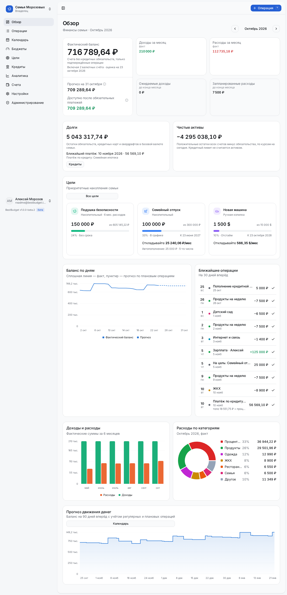
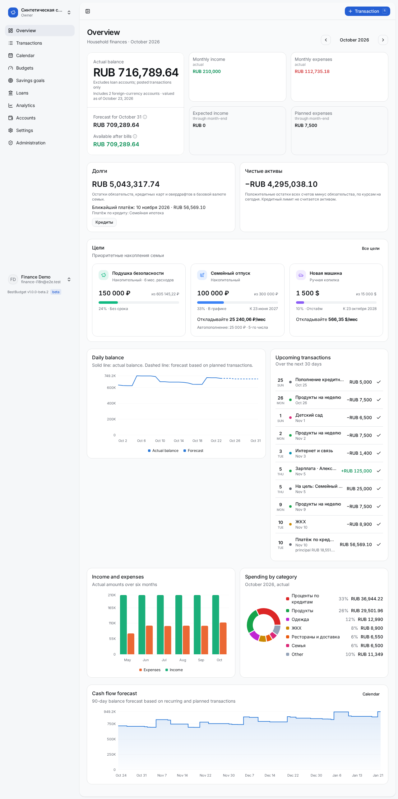
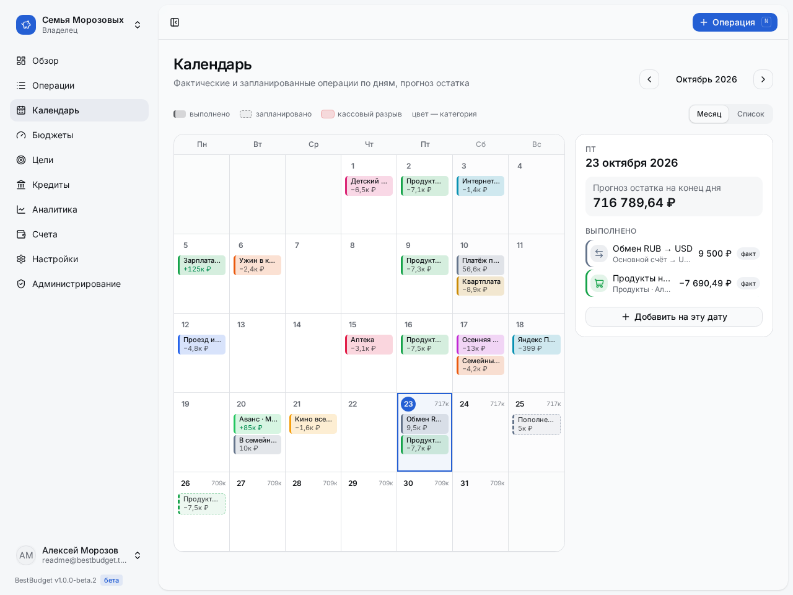
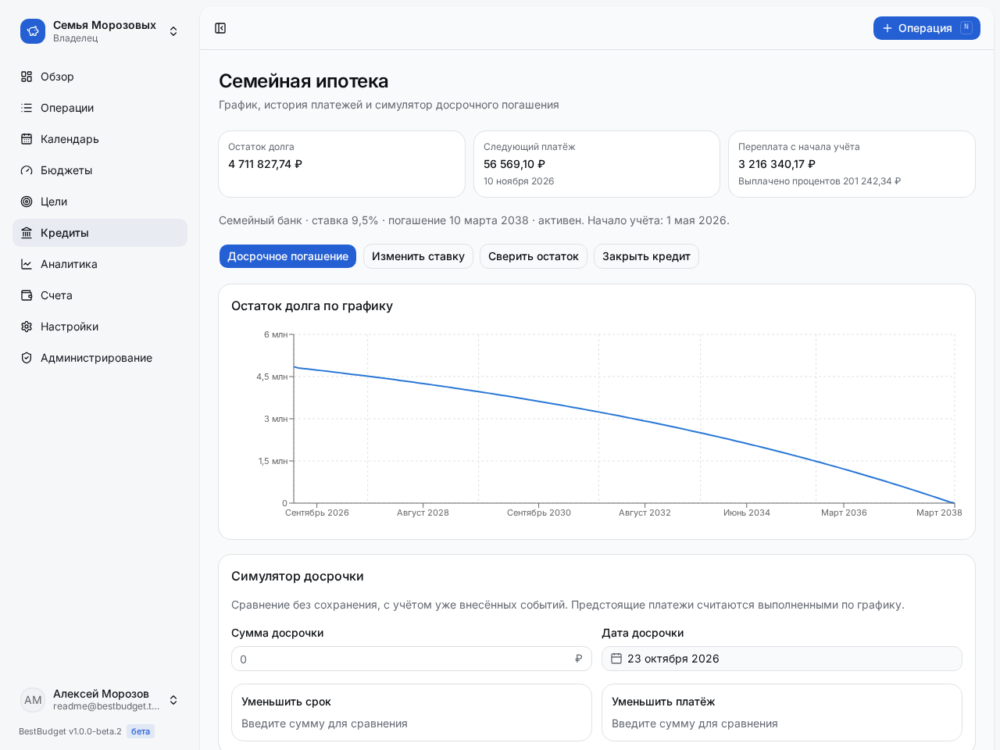
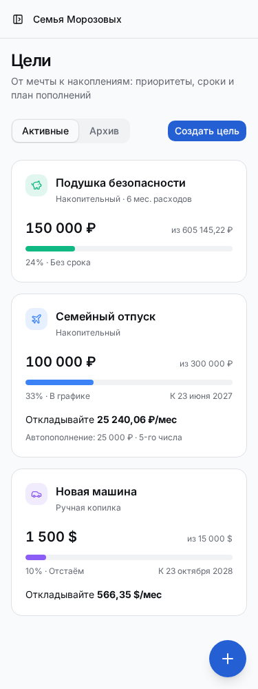
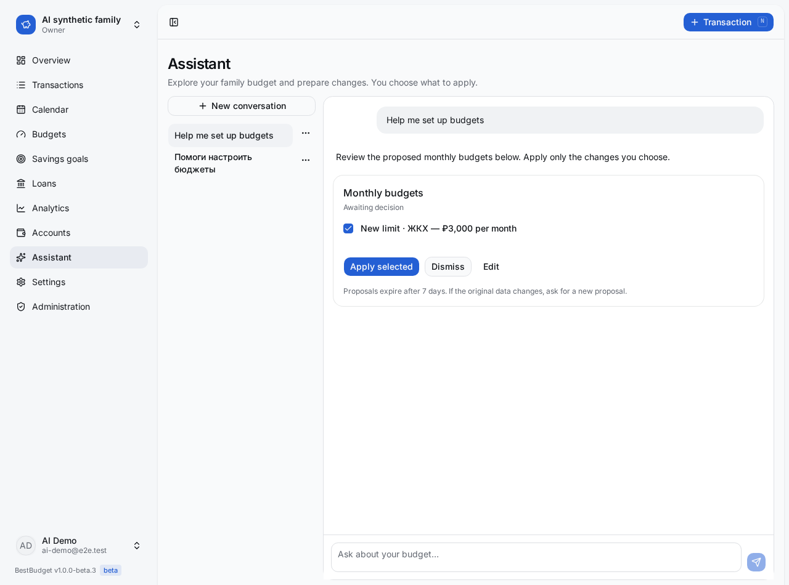
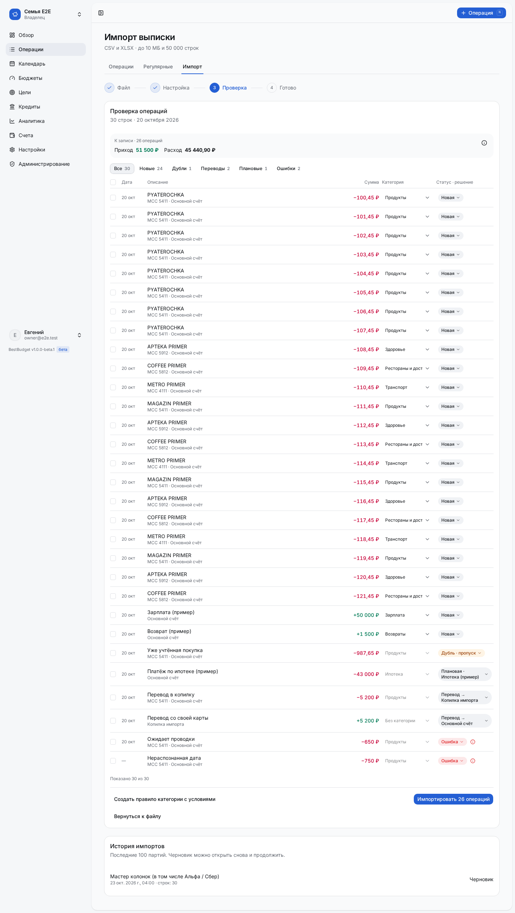

# BestBudget

English | [Русский](README.ru.md)

Self-hosted family finance: planned vs actual spending, recurring payments and cash-gap forecasts. Built for the Russian banking market, usable anywhere with your own currencies and household time zone.

[](https://github.com/mambastick/bestbudget/actions/workflows/ci.yml)
[](https://github.com/mambastick/bestbudget/releases)
[](LICENSE)

**1.0.0-beta.5 (beta).** The interface supports English and Russian, follows the system language and lets each user choose a language and theme. Detailed docs are currently in Russian.

## Screenshots

Synthetic demo data, light theme. No bank credentials or real family finances.



<details>
<summary>English interface, calendar, mortgage schedule, mobile savings goals and AI chat</summary>



<picture>
  <source media="(prefers-color-scheme: dark)" srcset="docs/screenshots/readme/calendar-dark.png">
  
</picture>

<picture>
  <source media="(prefers-color-scheme: dark)" srcset="docs/screenshots/readme/goals-mobile-dark.png">
  
</picture>



</details>

## Features

- Interface in English and Russian, follows the system language.
- Light/dark/system theme.
- Installable on the home screen (PWA).

- **AI assistant:** optional chat with self-hosted models or cloud providers, a guided budget interview and periodic reviews. Financial changes always require your confirmation. Admin UI or ENV setup, household consent and privacy levels; [AI guide](docs/ai.md).
- **Tracking and planning:** income, expenses, transfers, planned/posted/skipped transactions, search, filters and CSV export. Reports keep actuals separate from forecasts.
- **Recurring payments:** daily, weekly, monthly and yearly schedules; several salary dates; confirm the actual amount/date, skip one occurrence or edit future payments.
- **Calendar and cash flow:** daily balance forecast, upcoming obligations and warnings about cash gaps; monthly category budgets without blocking transactions.
- **Multiple currencies:** accounts and transfers with separate debit/credit amounts; household base-currency reports; cached Bank of Russia rates or manual rates for offline installations.
- **Loans:** mortgages and consumer loans, annuity/differentiated schedules, principal/interest split, prepayments, rate changes, debt reconciliation and credit-card limits.
- **Savings goals:** account allocations, manual contributions, emergency fund based on spending history, progress forecasts and recurring planned top-ups.
- **Statement import:** CSV/XLSX column mapping, preview, duplicate checks, own transfers, planned-payment confirmation, category rules and batch undo. [Import guide](docs/import.md).
- **Reminders:** opt-in Telegram and Web Push for payments, overdue items, cash gaps and budget overruns; quiet hours and daily digests. [Notifications](docs/notifications.md).
- **Family and access:** multiple households, one-time invitations, owner/admin/member roles, password login and generic OIDC SSO. System admins manage the installation without access to other households' finances.
- **Operations:** scheduled PostgreSQL backups, optional S3 upload, Docker Compose and Helm; responsive light/dark UI and installable PWA. PWA does not cache financial pages for offline use.

## Quick start — Docker Compose

Requires Docker Engine with Compose v2 and a Linux server/NAS. No source checkout or registry login needed:

```bash
mkdir bestbudget && cd bestbudget
curl -fL https://raw.githubusercontent.com/mambastick/bestbudget/v1.0.0-beta.5/compose.yaml -o compose.yaml
curl -fL https://raw.githubusercontent.com/mambastick/bestbudget/v1.0.0-beta.5/.env.example -o .env
mkdir -p backups
chmod 600 .env
```

Set these four values in `.env`:

| Variable | Value |
|---|---|
| `APP_URL` | Public URL, e.g. `https://budget.example.com`. **PWA requires HTTPS**, except `http://localhost`; LAN HTTP is insufficient |
| `BETTER_AUTH_SECRET` | Output of `openssl rand -base64 32` |
| `POSTGRES_PASSWORD` | Output of `openssl rand -hex 16` |
| `SETUP_TOKEN` | A separate `openssl rand -hex 16` |

On Linux, set `LOCAL_UID`/`LOCAL_GID` to the numeric output of `id -u` / `id -g` if your non-root account differs from `1000:1000`. Create `backups` as that user; for installation as root, run `chown 1000:1000 backups`.

```bash
docker compose up -d
```

Open `APP_URL/setup`, enter `SETUP_TOKEN` and create the first administrator. Create a household, then invite your family from **Settings → Family**. Setup closes once an administrator exists; you may remove `SETUP_TOKEN` afterwards.

Compose pulls `ghcr.io/mambastick/bestbudget:1.0.0-beta.5` (amd64/arm64), runs migrations automatically and stores PostgreSQL data in the `pgdata` volume. Health endpoint: `/api/health`.

For internet access, use an HTTPS reverse proxy. Set `APP_URL` to the external URL; forward `Host`, `X-Forwarded-Host`, `X-Forwarded-Proto`. Enable `TRUST_PROXY=true` only behind a trusted proxy; bind to `APP_BIND=127.0.0.1` when the proxy runs on the same host. [Proxy and SSO setup](docs/sso.md).

## Kubernetes — Helm

An ingress controller, TLS configuration and persistent storage are prerequisites. Scheduled backups require Kubernetes 1.27+.

```bash
helm install bestbudget oci://ghcr.io/mambastick/charts/bestbudget --version 1.0.0-beta.5 \
  --namespace bestbudget --create-namespace \
  --set appUrl=https://budget.example.com \
  --set ingress.enabled=true --set ingress.className=nginx --set ingress.tls.enabled=true
```

Helm prints instructions for retrieving the setup token. Generated secrets survive upgrades. See the [chart README](deploy/helm/bestbudget/README.md) for external PostgreSQL, existing Secrets, storage and all values.

## Install on your phone

Open BestBudget over HTTPS. On iPhone/iPad, use Safari → Share → Add to Home Screen; on Android, choose **Install app** from the BestBudget user menu or your browser. The installed iOS app has separate storage: sign in inside the app if needed. Financial data requires a connection; the offline page offers a retry. See the [installation, sessions and updates guide](docs/pwa.md) (in Russian).

## Configuration

See [`.env.example`](.env.example) for the complete list. Optional services can also be configured in the admin UI where indicated.

| Environment variable | Default / purpose |
|---|---|
| `BESTBUDGET_VERSION` | `1.0.0-beta.5`; Compose image tag |
| `APP_URL` | Required public URL; cookies, origin checks, invitations and SSO callback. **HTTPS is required for PWA** (except localhost) |
| `BETTER_AUTH_SECRET`, `SETUP_TOKEN` | Required session secret and first-run setup token |
| `ENCRYPTION_KEY` | Optional; otherwise derived from `BETTER_AUTH_SECRET`. Preserve it when restoring encrypted settings |
| `POSTGRES_*`, `DATABASE_URL` | Compose database credentials; `DATABASE_URL` is needed when running outside Compose |
| `APP_PORT`, `APP_BIND`, `TRUST_PROXY` | `3000`, `0.0.0.0`, `false`; network and trusted proxy |
| `FX_PROVIDER` | `cbr`; `none` disables rate-provider network requests, keeping saved/manual rates |
| `BACKUP_ENABLED` | `true`; set `false` to disable automatic Compose dumps, keeping manual backup/restore commands available |
| `TZ`, `BACKUP_TIME`, `BACKUP_PATH`, `BACKUP_KEEP_*` | `Europe/Moscow`, `03:00`, `./backups`, newest 7 plus all from 30 days; [backups](docs/backup.md) |
| `BACKUP_S3_BUCKET`, `AWS_*`, `BACKUP_S3_*` | Optional S3 upload; [backup settings](docs/backup.md#s3) |
| `JOBS_ENABLED` | `true`; built-in reminder scheduler |
| `TELEGRAM_BOT_TOKEN`, `TELEGRAM_MODE` | Empty / polling; admin UI or ENV; [notifications](docs/notifications.md) |
| `VAPID_PUBLIC_KEY`, `VAPID_PRIVATE_KEY`, `VAPID_SUBJECT` | Optional override; key pair otherwise generated and stored; [Web Push](docs/notifications.md#web-push) |
| `OIDC_ISSUER`, `OIDC_CLIENT_ID`, `OIDC_CLIENT_SECRET`, `OIDC_ALLOW_SIGNUP` | Empty issuer uses UI settings; new SSO accounts require invitations by default; [SSO](docs/sso.md) |
| `AI_PROVIDER`, `AI_BASE_URL`, `AI_API_KEY`, `AI_MODEL`, `AI_ENABLED`, `AI_MONTHLY_TOKEN_LIMIT` | Optional AI override; disabled by default. Admin UI, tool check and household owner consent; [AI guide](docs/ai.md) |
| `AUTH_FORCE_LOCAL_LOGIN` | `false`; emergency password-login recovery |
| `SMTP_URL`, `SMTP_FROM` | Optional self-service password reset; otherwise an admin resets passwords |

## Statement import

Open **Transactions → Import statement**, upload CSV/XLSX and map columns and accounts. Check the preview before posting: identify duplicates and your own transfers, confirm matching planned transactions and choose categories. Save category rules for similar purchases and reusable column profiles for your household.

A batch posts atomically; its history lets you undo unchanged imported transactions and restore confirmed plans. Pending bank holds are skipped until the bank posts them. BestBudget CSV v1 and exported transactions are supported; bank-specific profiles are **experimental** and require preview checks. **PDF is not supported**; save old XLS files as CSV/XLSX first. [Workflow, formats and undo limits](docs/import.md).

<details>
<summary>Statement import preview</summary>



</details>

## Upgrading and backups

Read the [changelog](CHANGELOG.md) and make a backup using the installed version:

```bash
docker compose run --rm backup now
# Set BESTBUDGET_VERSION=1.0.0-beta.5 in .env and update compose.yaml from the release tag.
docker compose pull
docker compose up -d
```

Migrations run automatically, including upgrades from beta.1. Keep your previous version, `.env` and encryption/session secrets with the backup. Schema downgrades are not automatic.

Database backups are the administrator's responsibility. Built-in dumps are a convenience if you have no backups of your own; if you already back up PostgreSQL (snapshots, pgBackRest, Velero, CloudNativePG or a managed database), set `BACKUP_ENABLED=false` in Compose or `backup.enabled=false` in Helm. Compose defaults to enabled; Helm defaults to disabled. **On Helm upgrades, explicitly set `backup.enabled=true` if you use built-in backups.** A logical dump still helps with server transfers: its filename includes the app version, and migrations run when the app starts after restore.

When enabled, Compose backs up nightly at 03:00 in `TZ`, retaining the newest 7 copies plus every copy from the last 30 days. Keep an off-server copy and test a restore into a separate database. [Backup, S3 and restore instructions](docs/backup.md).

## Security notes

- Public registration and SSO auto-provisioning are off by default. Use invitations; enable public access deliberately.
- Preserve `BETTER_AUTH_SECRET` and `ENCRYPTION_KEY`. Stored OIDC/Telegram/push secrets are encrypted; changing the encryption key makes existing encrypted settings unreadable. Keep `.env` private.
- Link SSO to your administrator account before disabling password login. Unusable SSO configuration falls back to password login; an identity-provider outage may require `AUTH_FORCE_LOCAL_LOGIN=true` and a container restart. Accounts are never automatically linked by matching e-mail. [Recovery and CLI](docs/sso.md).
- Serve remote access over HTTPS. Telegram, browser push services and the rate provider receive requests only for their enabled features; bank credentials are not needed.

## Development

Node.js 22+ and pnpm 10.27.0. Docker is optional: `db:dev` starts PGlite over the PostgreSQL wire protocol.

```bash
npx -y pnpm@10.27.0 install --frozen-lockfile
cp .env.example .env
# Set APP_URL=http://localhost:3300, DATABASE_URL=postgres://postgres@127.0.0.1:54340/postgres,
# BETTER_AUTH_SECRET and SETUP_TOKEN in .env.
PGLITE_PORT=54340 npx -y pnpm@10.27.0 db:dev
# In another terminal:
npx -y pnpm@10.27.0 db:migrate
PORT=3300 npx -y pnpm@10.27.0 dev
```

| Command (prefix with `npx -y pnpm@10.27.0`) | Purpose |
|---|---|
| `typecheck`, `lint`, `test` | TypeScript, ESLint, Vitest with isolated PGlite and real migrations |
| `build` | Production standalone build and bundled administration/backup CLIs |
| `test:e2e` | Playwright on production; isolated ports **3200/54330**, must be free; [matrix tests](docs/e2e.md) |
| `db:generate --name <name>` | Generate an additive migration after schema changes |
| `db:seed-demo <email>` | Six months of synthetic data; requires an empty RUB household and its single default account. Includes synthetic FX rates; use only a demo database |
| `test:screenshots readme.spec.ts` | Recreate README images and inspect all pages at 1280/375 px, light/dark |

Install the browser once: `npx -y pnpm@10.27.0 exec playwright install chromium`. An existing Chromium can be selected with `PLAYWRIGHT_CHROMIUM_EXECUTABLE`. Helm checks: `./scripts/check-helm.sh`. Docker build/backup/restore smoke checks run in CI.

Vitest freezes wall time before each test (default: `2026-10-23T09:00:00Z`). Override it with `TEST_NOW`, for example `TEST_NOW=2026-12-31T20:30:00Z npx -y pnpm@10.27.0 test`. CI runs the full suite on an ordinary day, a Sunday and December 31 at 23:30 Moscow time; tests with date-specific contracts set their own clock.

## Architecture and contributing

Next.js 16 App Router · React 19 · TypeScript strict · Tailwind 4 · shadcn/Base UI · Drizzle · PostgreSQL 17 · Better Auth · Recharts.

[Architecture and data model](docs/architecture.md). Money uses integer minor units; dates belong to the household time zone; financial references enforce household isolation. Domain logic lives in services, server actions validate inputs and return structured results.

Issues and pull requests are welcome. Describe the problem and reproduction steps; include checks and screenshots for UI changes. Keep migrations additive, use existing UI components and avoid new heavy dependencies. UI messages live in per-area English/Russian dictionaries; follow the [i18n conventions](docs/i18n.md). Code and code comments are English. Never attach real statements, credentials or personal financial data to public issues.

## Roadmap

- Validate native profiles for Sber, T-Bank and Alfa-Bank using locally anonymized real statement samples. Current bank formats remain experimental; column mapping is available.
- Optional IMAP attachments and Android SMS/push **drafts**, with user review before posting.
- Monitor Russian Open Banking access for self-hosted clients; no direct retail-bank API integration or availability date is promised. See the [banking research](docs/research/bank-integrations-ru.md) and [statement format study](docs/research/statement-formats.md).

## License

[MIT](LICENSE), copyright © 2026 BestBudget.

Vendored components retain their [third-party licenses](THIRD_PARTY_NOTICES.md),
including Commons Clause restrictions for React Bits and Animate UI.
