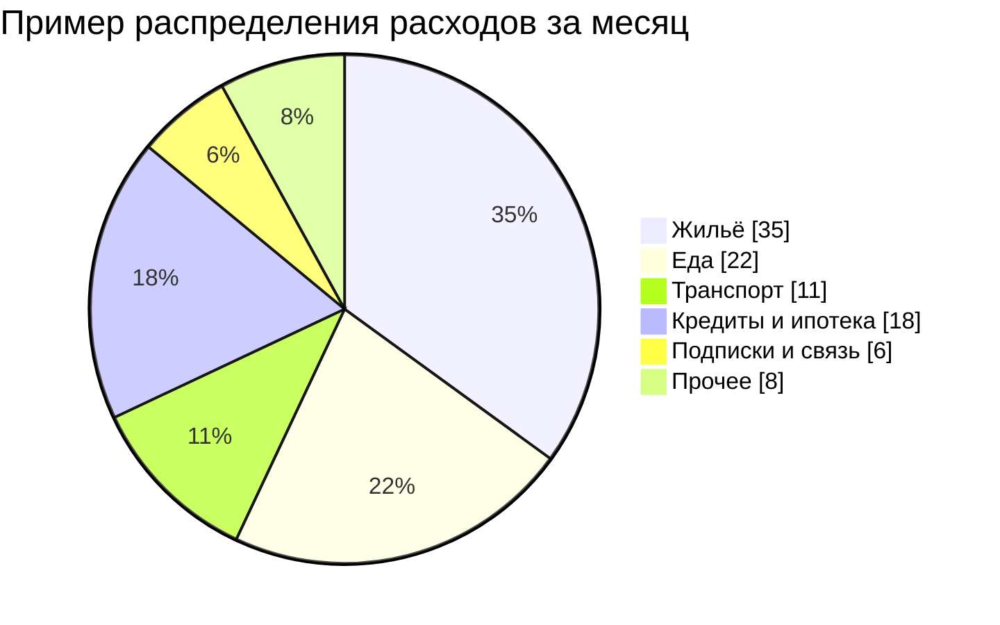
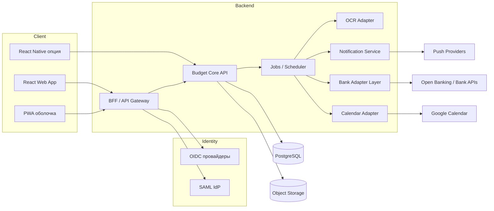
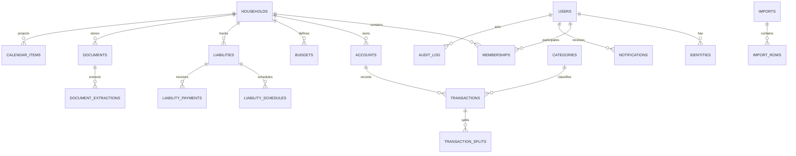
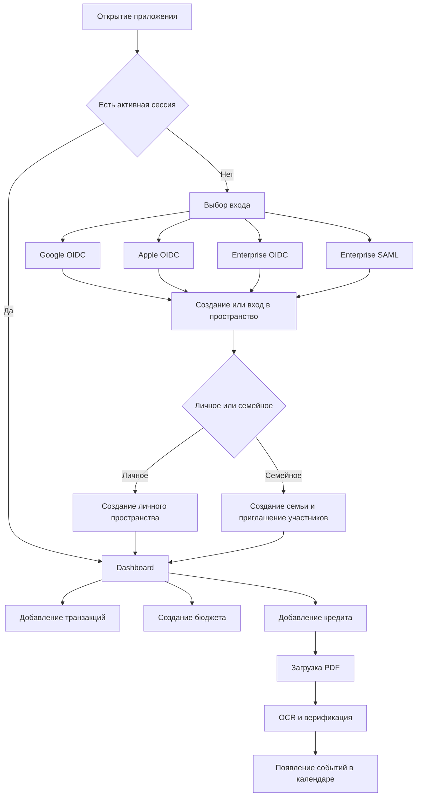
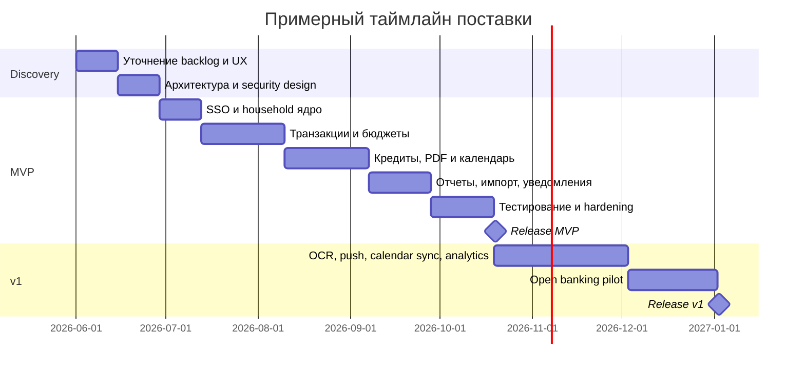

# Техническое задание на разработку приложения для личного и семейного бюджета

## Исполнительное резюме

Цель проекта — разработать веб-приложение с мобильным сценарием использования для ведения личного и семейного бюджета, в котором пользователь сможет учитывать доходы и расходы, вести совместные семейные счета, планировать платежи, хранить и обрабатывать данные по кредитам и ипотека́м, загружать официальные PDF-документы, получать аналитику и работать с календарем, где при выборе даты в правой панели отображаются операции, платежи, начисления и напоминания. Для идентификации должны поддерживаться SSO через OAuth 2.0 / OpenID Connect и SAML, а для UI необходимо использовать только готовые компоненты из shadcn/ui и React Bits без разработки собственных компонентных примитивов. Официальные реестры shadcn/ui уже содержат компоненты, необходимые для целевого интерфейса, включая Calendar, Data Table, Chart, Dialog, Drawer, Sheet, Sidebar, Tabs, Table, Resizable и Scroll Area; React Bits предоставляет открытый набор кастомизируемых React-компонентов и анимированных UI-элементов, подходящих для декоративных и статусных блоков, а не для критичных финансовых форм. citeturn13view0turn15search7turn0search5

Рекомендуемая целевая архитектура для передачи в разработку — **web-first с PWA как базовой мобильной стратегией**, **React + TypeScript** на фронтенде, **Node.js + TypeScript** на бэкенде, **PostgreSQL** как основной реляционной БД и **объектное хранилище** для PDF-документов. Для веб-клиента предпочтительна схема **BFF** для безопасного обращения с токенами и сессиями; для SSO по стандартам OIDC необходимо использовать discovery-метаданные провайдера, а для native/mobile-сценариев — best practice с внешним браузерным user-agent. PostgreSQL нативно поддерживает declarative partitioning и row-level security, что делает его подходящим для изоляции семейных пространств и последующего масштабирования/архивации. citeturn21search0turn21search12turn24view2turn11search0turn31view0turn4search0turn4search1

Так как пользователь **не указал мобильную платформу и юрисдикцию**, в этом ТЗ зафиксированы две мобильные опции — **PWA** и **React Native** — и применен общий baseline по защите данных и доступности: шифрование персональных данных, аудит действий, разграничение доступа, базовый WCAG-профиль, secure development по OWASP ASVS и правовая модель уровня GDPR-like baseline с обязательным юридическим gap-analysis перед production-релизом. Для открытого банкинга требования сформулированы как **опциональный интеграционный контур**, поскольку в EEA и UK он завязан на PSD2 / SCA и соответствующие Open Banking-стандарты, а модель лицензирования и допустимые сценарии зависят от того, ограничивается ли приложение агрегацией данных или инициирует платежи. citeturn6search15turn35search20turn5search1turn5search17turn5search2turn3search0turn3search2turn3search3turn32search11turn32search12

Это ТЗ намеренно сделано **практичным и исполнимым**: в нем зафиксированы область проекта, функциональные и нефункциональные требования, модель данных, API-контракт уровня примеров, архитектурные решения, требования к SSO и хранению документов, экранная структура, подбор готовых компонентов, а также примерный план поставки, релизов и оценок трудозатрат. В качестве приоритетной нормативной и технической базы использованы официальные материалы shadcn/ui, React Bits, OpenID Foundation, IETF OAuth RFC, OASIS SAML, Google/Apple/Microsoft identity docs, European Commission / EBA / Open Banking, PostgreSQL, W3C WCAG и OWASP ASVS. citeturn13view0turn15search7turn24view1turn24view2turn24view3turn23view0turn26view0turn27view0turn3search0turn3search3turn4search10turn5search1turn5search2

## Предпосылки и рамки проекта

### Продуктовая цель

Приложение должно помогать пользователю и семье принимать финансовые решения на основе единой картины по доходам, расходам, обязательствам, зарплате, документам и платежному календарю. Оно должно закрывать сразу три сценария:  
**операционный** — быстро занести и найти финансовую операцию;  
**плановый** — понимать, что и когда нужно оплатить;  
**аналитический** — видеть тренды, отклонения от бюджета и нагрузку по долгам.

### Целевые пользовательские роли

| Роль | Назначение | Основные права |
|---|---|---|
| Владелец пространства | Создает личное/семейное пространство | Полные права, смена тарифов, удаление пространства |
| Семейный администратор | Управляет участниками и общими счетами | Приглашения, роли, доступ к семейным данным |
| Участник семьи | Ведет операции и видит разрешенные счета | Создание/редактирование операций в пределах прав |
| Наблюдатель | Просмотр бюджета, календаря, отчетов | Только чтение |
| Финансовый помощник | Опциональная роль для бухгалтера/супруга | Ограниченные права на импорт, верификацию OCR и отчеты |

### Базовые допущения

| Область | Зафиксированное допущение | Последствие для разработки |
|---|---|---|
| Мобильная стратегия | Платформа не указана; базовый вариант — адаптивный web + PWA, альтернативный — React Native | PWA закрывает installability, offline и web push; React Native нужен, если приоритетом станут store-distribution, глубокие device API и нативный UX |
| Юрисдикция | Страна/правовой режим не указаны | В ТЗ заложен GDPR-like baseline; до запуска нужен legal review по стране развертывания и рынкам пользователей |
| Банковские интеграции | Считать опциональными, запускать как read-only aggregation, а не payment initiation | Уменьшается регуляторная сложность; платежная инициация выносится в отдельный этап |
| Бюджет и сроки | Не указаны | Далее приведены только ориентировочные диапазоны человеко-месяцев и фаз |

### Границы первой версии

В этом ТЗ рекомендуется разделить объем на три слоя.

**Обязательный базовый слой**: учет транзакций, семейные пространства, бюджеты, долги, документы PDF, зарплата/распределение, календарь, отчеты, уведомления, SSO, импорт/экспорт CSV, аудит.  

**Опциональный слой v1**: read-only Open Banking, OCR-извлечение графиков платежей, Google Calendar sync, push-уведомления, многовалютность, advanced debt analytics.  

**Опциональный слой v2**: React Native-приложение, сценарии досрочного погашения с what-if моделированием, платежные провайдеры, расширенная автоматизация правил, семейные цели и накопления.

Такое деление обосновано не только размером работ, но и регуляторной и технической сложностью: PSD2 и сопутствующие RTS/SCA регулируют безопасный доступ к платежным данным и онлайн-платежам; Open Banking в UK опирается на отдельный стандарт API; а production-подключение внешних провайдеров календаря, OCR и push требует отдельной инфраструктуры согласий и безопасного хранения учетных данных. citeturn3search0turn3search2turn3search10turn32search11turn19view0turn10search0turn8search0turn9search0

### Выбор мобильной опции

| Критерий | PWA | React Native |
|---|---|---|
| Кодовая база | Максимально единая с web | Частично отдельная mobile-кодовая база |
| Установка | Installable через браузер | App Store / Google Play |
| Offline | Через service worker и кэширование | Нативно, гибко |
| Push | Web Push и FCM; Safari/web apps поддерживаются отдельным стандартным механизмом | FCM/APNs, нативные SDK |
| Доступ к устройству | Ограниченный/браузерный | Сильнее и стабильнее |
| Time-to-market | Быстрее | Дольше |
| Рекомендация | **Базовый выбор для MVP** | Подключать, если нужен полноценный mobile-first канал |

PWA имеет сильные преимущества для первого релиза: это один кодовый базис, installability и поддержка надежной работы через service workers, которые обеспечивают offline-сценарии, push notifications и background sync. React Native, в свою очередь, строится на нативных компонентах и лучше подходит, если продукт изначально ориентирован на App Store / Google Play и глубокую интеграцию с системными возможностями устройства. На iOS web push для веб-приложений и браузеров Apple документирован отдельно, а для нативных приложений стандартным каналом остаются APNs и mobile SDK. citeturn7search5turn7search2turn7search13turn7search20turn10search2turn10search11

**Рекомендация для этого ТЗ**:  
для MVP — **React web + PWA**;  
React Native — как отдельный workstream начиная с v1.5/v2.

## Функциональные требования

### Функциональные блоки и состав возможностей

| Блок | Обязательный функционал | Комментарий по реализации |
|---|---|---|
| Учёт доходов и расходов | Ручное создание, редактирование, удаление, дублирование, split-транзакции, переводы между счетами, recurring операции | Поддержать типы: income, expense, transfer, adjustment, scheduled |
| Категории и теги | Иерархия категорий, пользовательские категории, теги, цветовая маркировка | Категории семейные и личные |
| Бюджеты | Бюджеты по категориям и периодам (месяц/квартал/год), лимиты, фактическое исполнение, rollover как опция | Минимум — monthly budget |
| Семейные счета | Совместные пространства, общие счета, персональные счета внутри семьи, роли и права | Разграничение на уровне household/account |
| Планирование платежей | Запланированные расходы/доходы, напоминания, статус исполнения, автосвязь с календарем | Поддержать recurring rules и one-off события |
| Кредиты и ипотеки | Сумма, ставка, тип графика, срок, платежи, остаток, даты погашения, просрочки, досрочные погашения | Поддержать аннуитет, дифференцированный и ручной график |
| PDF-документы | Загрузка официальных PDF, versioning, preview, привязка к кредиту/счету/операции | Оригинал хранится отдельно от результатов OCR |
| Зарплата и распределение | Профиль зарплаты, периодичность, ожидаемая дата, распределение по счетам/категориям/долгам/накоплениям | Нужен rule engine для fixed amount и percent-based rules |
| Импорт/экспорт | CSV import/export, шаблоны колонок, дедупликация, preview before commit | Асинхронный импорт и журнал ошибок |
| Отчеты и аналитика | Диаграммы, cashflow, category breakdown, budget vs actual, debt burden, forecast | Срезы по пользователю, семье, счету, периоду |
| Уведомления | Email, web push, mobile push, in-app reminders | Каналы настраиваются пользователем |
| Календарь | Месячный/недельный режим, click on date, справа список операций/платежей/зачислений | Это ключевой UX-элемент, обязателен уже в MVP |
| Аудит | Журнал действий: auth, role changes, imports, OCR correction, doc access, exports | Не редактируется пользователем |

### Детализация ключевых пользовательских сценариев

#### Учёт операций

Система должна позволять пользователю создавать транзакции вручную и через импорт. Каждая транзакция должна иметь минимум: тип, сумму, валюту, дату операции, дату фактического списания/зачисления, счет, категорию, владельца, признак семейной или личной операции, заметку, теги и необязательную связь с документом или обязательством. Для переводов между счетами система не должна удваивать расход и доход в отчетах, а должна хранить пару связанных записей или отдельную сущность transfer.  

Дополнительно требуется поддержать recurring-шаблоны: ежемесячная аренда, коммунальные платежи, зарплата, подписки, погашение кредита. Если шаблон был создан заранее, календарь должен отражать его как planned item до того момента, пока не появится actual transaction. После появления actual item статусы должны перейти в `completed`, а отклонения по сумме/дате — подсветиться как variance.

#### Семейные пространства и счета

Пользователь может создать личное пространство или семейное пространство. Семейное пространство включает участников, роли, общие категории, общие бюджеты, общие долги и общие документы. Участник семьи может иметь доступ ко всем счетам или только к выделенным. Доступ к строкам данных должен проверяться и на уровне приложения, и на уровне БД. PostgreSQL поддерживает row-level security, поэтому для семейных пространств рекомендуется tenant/household-aware модель запросов и политик доступа. citeturn4search1turn4search9

#### Зарплата и ее распределение

Система должна хранить один или несколько профилей дохода: зарплата, подработка, дивиденды, пособия и другие регулярные поступления. Для зарплаты обязателен механизм **распределения**: например, 50% на общий семейный счет, 20% в резерв, 15% на ипотеку, 10% на инвестиционный/накопительный счет, 5% на discretionary spending.  

Правила распределения должны поддерживать:
- фиксированные суммы;
- проценты;
- приоритетный порядок списания;
- привязку к календарной дате;
- исключения на конкретный месяц;
- ручное подтверждение или автоприменение.

#### Кредиты и ипотеки

Кредитный модуль является одним из центральных. На карточке обязательства должны храниться:

| Поле | Обязательно | Примечание |
|---|---|---|
| Тип обязательства | Да | Кредит, ипотека, автокредит, рассрочка, кредитная линия |
| Кредитор | Да | Банк/организация |
| Валюта | Да | ISO-код |
| Сумма основного долга | Да | На дату открытия |
| Текущий остаток | Да | Обновляется фактическими платежами |
| Процентная ставка | Да | Фиксированная или плавающая |
| Формула/тип графика | Да | Аннуитет / дифференцированный / ручной |
| Дата начала | Да |  |
| Дата окончания | Да | Плановая |
| Дата ближайшего платежа | Да | Рассчитывается и кэшируется |
| Ежемесячный платеж | Да | Плановый |
| Досрочные погашения | Нет | Но поддержка желательна уже в v1 |
| Штрафы/пени | Нет | Опционально |
| Связанные документы | Да | Договор, допсоглашения, график |
| Источник данных | Да | Manual / OCR / Imported / API |

Для ипотек и кредитов система должна уметь:
- показывать плановый график платежей;
- сверять факт против графика;
- хранить оригинальный PDF-документ;
- извлекать из документа поля через OCR;
- маркировать OCR-поля confidence score и отправлять их на ручную верификацию;
- показывать календарные события для ближайших и просроченных платежей;
- пересчитывать остаток и ожидаемую нагрузку после фактического платежа;
- поддерживать несколько документов на одно обязательство с версионностью.

Для OCR-слоя допустимы несколько провайдеров. Google Document AI указывает, что Enterprise Document OCR может извлекать блоки, абзацы, строки, слова и структуру из PDF и изображений; Azure Document Intelligence описывает OCR и извлечение текста, таблиц, структуры и key-value pairs; Amazon Textract поддерживает анализ PDF и извлечение текста, форм и таблиц. Это оправдывает выбор провайдер-агностичного OCR-адаптера с единым внутренним контрактом извлечения. citeturn8search0turn9search0turn9search1turn8search13

#### Документы PDF

Официальный PDF-документ всегда является **источником-артефактом**, который хранится неизменным. Все извлеченные данные должны храниться отдельно, с указанием:
- версии OCR-пайплайна;
- даты обработки;
- confidence score;
- статуса верификации человеком;
- связанного объекта домена;
- журнала исправлений.

Требования к документам:
- поддержка PDF upload через UI и API;
- ограничение на размер файла, например 25–50 МБ;
- MIME/type validation;
- антивирусная проверка;
- объектное хранение с signed access;
- превью, постраничный просмотр и скачивание;
- поиск по метаданным и по извлеченному тексту;
- role-based access и аудит скачиваний/просмотров.

#### Календарь

Календарь — обязательный первоклассный модуль. Основной режим — **месячная сетка**. При клике по дате справа в отдельной панели должны отображаться:
- запланированные платежи;
- ожидаемые зачисления;
- фактические операции, которые уже привязаны к дате;
- просроченные обязательства, если их плановая дата меньше выбранной;
- фильтры по типу записи, счету, категории, пользователю, семейному пространству.

Правила поведения:
1. При открытии экрана показывается текущий месяц.  
2. Даты с событиями подсвечиваются индикаторами разных цветов: доход, расход, долг, напоминание.  
3. При клике по дате правая панель открывается или обновляется без полной перезагрузки страницы.  
4. При клике по элементу из правой панели открывается detail drawer/sheet.  
5. На одной дате могут существовать planned и actual сущности; UI должен визуально различать их.  
6. Должен поддерживаться переход “из долга в календарь” и “из календаря в долг”.

#### Отчеты и аналитика

Минимальный набор отчетов:
- cashflow по месяцам;
- расходы по категориям;
- исполнение бюджета по категориям;
- доходы по источникам;
- динамика долговой нагрузки;
- прогноз свободного остатка до конца месяца;
- семейная vs личная доля расходов;
- календарь обязательств на 30/60/90 дней.

Пример визуализации сводного отчета по категориям:



## Архитектура и технологии

### Рекомендуемая архитектурная схема

С точки зрения безопасности и поддержки SSO для браузерного приложения оптимален сценарий **BFF + API Core**. В draft BCP для browser-based applications паттерн BFF описан как самый защищенный из основных вариантов: backend берет на себя OAuth-обязанности, управляет access/refresh tokens в cookie-based session и не раскрывает токены браузерному приложению. Для web-клиента это лучший компромисс между безопасностью и UX. citeturn31view0turn31view3



### Целевой стек

| Слой | Рекомендуемый выбор | Альтернативы | Комментарий |
|---|---|---|---|
| Web frontend | React + TypeScript | React framework по выбору команды | Основа обязательна по требованию |
| Mobile | PWA baseline | React Native | Решение зависит от go-to-market |
| UI | shadcn/ui + React Bits | Нет | Собственные примитивы запрещены |
| Backend | Node.js + TypeScript | Go / Kotlin / Java как enterprise-альтернатива | Для этого ТЗ — Node/TS как приоритет |
| API | REST как primary, GraphQL read-gateway как опция | Только REST | GraphQL особенно полезен для dashboard/calendar aggregation |
| DB | PostgreSQL | Нет для primary DB | Обязательный выбор по требованию |
| File storage | S3-compatible object storage | Cloud-native blob storage | Для PDF и экспортов |
| OCR | Google Document AI / Azure Document Intelligence / Amazon Textract | Любой совместимый провайдер | Только через adapter interface |
| Notifications | Email + FCM + Web Push + APNs bridge | Поставщик по выбору | Каналы зависят от web/native стратегии |
| Calendar integration | Google Calendar API | ICS export/import как базовая fallback-опция | Опционально, но заложить сразу в архитектуру |

Node.js официально описан как open-source cross-platform runtime, хорошо подходящий для серверов, web apps и low-latency streaming-сценариев; TypeScript добавляет поверх JavaScript строгую типизацию и tooling; PostgreSQL как текущая primary DB поддерживает partitioning, row-level security и расширения для криптографических функций. Это делает стек React/TypeScript + Node/TypeScript + PostgreSQL логично согласованным по языку, tooling и multi-tenant-безопасности. citeturn21search0turn21search12turn4search0turn4search1turn4search3

### Нефункциональные требования

| Категория | Требование |
|---|---|
| Доступность сервиса | SLA: 99.5% для MVP, 99.9% для v1 production |
| Производительность API | p95 read-запросы ≤ 300 мс; p95 write-запросы ≤ 500 мс; тяжелые отчеты — асинхронно |
| Производительность UI | Первый meaningful load ≤ 2.5 c на типовом broadband, календарь месяца ≤ 1 c |
| Масштабируемость | Горизонтальное масштабирование stateless backend и worker-процессов |
| Импорт CSV | До 100 000 строк асинхронно с progress tracking |
| Хранение документов | PDF до 25–50 МБ, versioning, signed download |
| Локализация | Русский обязательно; English-ready структура переводов |
| Таймзоны | Хранение в UTC; отображение в timezone пользователя/пространства |
| Бэкапы | Ежедневный full + инкрементальные; шифрование backup |
| RPO / RTO | MVP: RPO 24 часа, RTO 4 часа; v1: RPO 15 минут, RTO 2 часа |
| Мониторинг | Metrics, traces, structured logs, alerting |
| Логи | JSON logs, masking PII, correlation IDs |
| CI/CD | Автоматические проверки, тесты, security gates, миграции |
| Доступность интерфейса | Базовое соответствие WCAG 2.2 A/частично AA |
| Безопасная разработка | Контроль по OWASP ASVS baseline |

WCAG 2.2 определяет рекомендации для perceivable, operable, understandable и robust веб-контента и является базовой опорой для accessibility-профиля. OWASP ASVS предоставляет структурированную основу требований к техническим security controls и может использоваться как чеклист для приемки безопасной реализации. citeturn5search1turn5search17turn5search2

### Масштабирование, партиционирование и архивация

Для транзакций, аудита и событий календаря рекомендуется закладывать **партиционирование по периоду** и при необходимости по household/tenant. PostgreSQL прямо поддерживает declarative partitioning, а значит схема для объемных таблиц может быть изначально подготовлена к архивным партициям и cold storage-стратегии без смены СУБД. Для фактического “шардирования” следует сначала использовать логическое разделение, read-replicas и архивные партиции; полноценный cross-shard design имеет смысл только после подтвержденной нагрузки. citeturn4search0turn4search15

### Интеграции

| Интеграция | Назначение | Статус в ТЗ |
|---|---|---|
| Open Banking / PSD2 | Импорт счетов и операций из банков | Опция v1 |
| Платежные провайдеры | Платежи из приложения | Не включать в MVP; вынести в отдельный legal stream |
| OCR документы | Извлечение текста, таблиц, key-value данных из PDF | Включить adapter layer с возможностью ручной верификации |
| Google Calendar | Синхронизация целей/платежей/напоминаний | Опция v1 |
| Push notifications | Напоминания и статусы событий | Включить базовую поддержку в архитектуру |
| Email/SMTP | Дайджесты, приглашения, напоминания | Обязательно |

Google Calendar API документирован как API для календарей и событий, а в production-документации отдельно выделены reminders/notifications, resource synchronization и push notifications. Firebase Cloud Messaging описывается как cross-platform messaging solution для надежной доставки сообщений. Для открытого банкинга важна оговорка: европейский контур строится вокруг PSD2/SCA и лицензируемых сценариев доступа к данным, а в UK — вокруг Open Banking API Specifications. citeturn19view0turn10search0turn10search12turn3search0turn3search2turn3search10

## Безопасность и комплаенс

### SSO и федеративная аутентификация

#### Поддерживаемые режимы

| Режим | Обязательность | Сценарий |
|---|---|---|
| OIDC social login | Да | Google, Apple |
| OIDC enterprise | Да | Корпоративные IdP, Microsoft Entra ID, Keycloak и др. |
| SAML 2.0 | Да | Корпоративные IdP, legacy-enterprise federation |
| Local auth | Опционально | Только если нужен fallback без IdP; иначе можно исключить |

OpenID Connect — это identity layer поверх OAuth 2.0, который позволяет клиенту проверить личность пользователя на основе аутентификации у Authorization Server и получить базовые профильные claims. Discovery-спецификация OIDC определяет механизм получения `.well-known` метаданных провайдера, включая endpoint-ы и конфигурацию. SAML 2.0, в свою очередь, определяет XML-based framework для обмена security information между сторонами и покрывает web SSO use cases через IdP и SP. citeturn24view1turn24view2turn23view0

#### Требования к flow

| Платформа | Рекомендуемый flow | Примечание |
|---|---|---|
| Web с BFF | Authorization Code Flow; токены обмениваются и хранятся на сервере | Основной путь |
| Pure SPA fallback | Authorization Code + PKCE, без implicit flow | Только если BFF невозможен |
| Native mobile | Authorization Code + PKCE через внешний браузер/user-agent | Следовать RFC 8252 |
| Enterprise SAML | SP-initiated SSO обязательно, IdP-initiated SSO опционально | ACS endpoint, metadata import/export |

RFC 9700, текущий Best Current Practice по безопасности OAuth, прямо рекомендует не использовать implicit grant для response type `token`, поскольку он уязвим к утечке и replay access token-ов; вместо этого следует использовать response type `code`, чтобы access tokens не оказывались в URL и чтобы сервер мог лучше пресекать replay. PKCE стандартизован отдельным RFC и предназначен для защиты Authorization Code Grant от interception attack. Для native apps RFC 8252 рекомендует выполнять OAuth authorization requests только через внешние user-agents, прежде всего браузер пользователя. citeturn29view1turn29view3turn12view0turn11search0

#### Требования к настройке провайдеров

| Провайдер | Что нужно настроить | Особые требования |
|---|---|---|
| Google | OIDC client, redirect URI, consent screen, scopes | Отдельный client ID на каждую платформу |
| Apple | Sign in with Apple, Services ID для web, redirect URLs | Для web требуется Services ID и связка сайта с app ID |
| Microsoft Entra ID | App registration, redirect URIs, OIDC metadata | Поддержка tenant-aware authority и metadata URL |
| Корпоративный OIDC IdP | `.well-known/openid-configuration`, client registration | Импорт discovery metadata |
| Корпоративный SAML IdP | Metadata XML, ACS URL, Entity ID, X.509 certificates | Проверка подписи assertion/response |

Google официально публикует OIDC discovery document и endpoint-ы через well-known configuration URL; в production docs по OAuth-клиентам указывает, что для приложений на разных платформах требуется отдельный client ID для каждой платформы. Apple для web-конфигурации требует создание **Services ID** и привязку сайта к существующему App ID с включенным Sign in with Apple. Microsoft Entra ID публикует OpenID configuration document на публичном well-known endpoint и документирует параметры `openid`, `nonce`, `redirect_uri`, `response_mode=form_post` и tenant-specific authority URL. citeturn24view3turn25view0turn26view0turn27view0

### Хранение токенов и сессий

Для web-клиента обязательна стратегия **server-side token handling**:

| Артефакт | Где хранить | Требование |
|---|---|---|
| Access token | Только на сервере/BFF | Не раскрывать клиентскому JS |
| Refresh token | Только на сервере/BFF | Шифрование, rotation, scope minimization |
| Session identifier | Secure HttpOnly cookie | SameSite=Strict, `__Host-` префикс по возможности |
| ID token | На сервере для валидации и извлечения claims | Не хранить дольше, чем нужно для сессии |

В draft BCP для browser-based apps отдельно подчеркивается, что BFF использует cookies для пользовательской сессии и такие cookies должны быть защищены флагами `Secure` и `HttpOnly`; рекомендуется `SameSite=Strict`, путь `/` и отсутствие `Domain` для host-bound cookies. Тот же документ отмечает, что хранение токенов в cookies как JS-accessible storage practice **не рекомендуется**; а для BFF-сценария важен именно вариант, где cookie недоступна JavaScript и служит транспортом до backend. RFC 9700 дополнительно указывает на утечки токенов через browser history и URL, а потому access token-ы не должны передаваться в query parameters. citeturn31view2turn31view3turn29view3

### Защита данных и документов

GDPR устанавливает правила защиты персональных данных и требует подходящих технических и организационных мер безопасности для обработки; практические guidance по Article 32 акцентируют необходимость мер, соответствующих риску, включая шифрование, обеспечение конфиденциальности, целостности, доступности и устойчивости систем. В рамках данного продукта это означает:
- шифрование трафика по TLS;
- шифрование чувствительных полей и/или псевдонимизацию;
- KMS-managed ключи;
- минимизацию доступа к PII;
- разграничение прав по ролям и household;
- аудит доступа к документам и экспортам;
- настраиваемые политики retention. citeturn6search15turn35search20turn35search18turn35search4

Для PostgreSQL можно использовать `pgcrypto` как встроенный модуль криптографических функций, однако для высокочувствительных полей (например, номера договоров, внешние идентификаторы, данные о банке-кредиторе) предпочтительно сочетать **application-level encryption** с управлением ключами вне БД. PostgreSQL также документирует, что encrypted field storage и row-level security являются поддерживаемыми механизмами. citeturn4search3turn4search7turn4search1

### Комплаенс и регуляторика

#### Базовый комплаенс-профиль

| Область | Требование |
|---|---|
| Персональные данные | GDPR-like baseline до уточнения юрисдикции |
| Доступность | WCAG 2.2 basic profile |
| Безопасная разработка | OWASP ASVS baseline |
| Аудит | Логирование security-critical действий |
| Data export | Экспорт пользовательских данных в машиночитаемом виде |
| Data deletion | Поддержка soft delete / deletion workflow с учетом retention obligations |
| Incident response | Регламент обработки инцидентов и утечек |

#### Открытый банкинг

Если приложение будет подключать банковские счета пользователя, нужно заранее зафиксировать, что оно делает:
1. **только агрегирует данные** по согласию пользователя;  
2. **инициирует платежи**;  
3. делает и то, и другое.

Для EEA это различие принципиально: PSD2 и связанные с ней RTS/SCA направлены на безопасность платежей и защиту потребителей; account information services в правовом контуре PSD2 описываются как сервисы, предоставляющие агрегированную онлайн-информацию по одному или нескольким платежным счетам пользователя у одного или нескольких платежных провайдеров. Для UK нужно отдельно учитывать Open Banking Standard API Specifications. Поэтому в данном ТЗ open banking-интеграция закладывается как **adapter layer + consent model**, а legal/licensing stream выносится в отдельный трек. citeturn3search0turn3search2turn32search12turn32search4turn3search10

## Модель данных и API

### Ключевые сущности

| Сущность | Ключевые поля | Связи |
|---|---|---|
| users | id, email, display_name, locale, timezone, status | 1:M с identities, memberships, notifications |
| identities | id, user_id, provider_type, provider_subject, issuer, email_verified | M:1 к users |
| households | id, type, name, base_currency, owner_user_id | 1:M с memberships, accounts, budgets, liabilities |
| memberships | id, household_id, user_id, role, permissions_json | M:1 к users и households |
| accounts | id, household_id, owner_user_id nullable, type, name, currency, balance_mode | 1:M с transactions |
| account_balances | id, account_id, calculated_balance, actual_balance, as_of | M:1 к accounts |
| categories | id, household_id nullable, parent_id, kind, name, color | self-reference tree |
| tags | id, household_id, name | M:N с transactions |
| transactions | id, account_id, household_id, user_id, type, amount, currency, booked_at, occurred_at, category_id, status | M:1 к accounts/categories/users |
| transaction_splits | id, transaction_id, category_id, amount | M:1 к transactions |
| recurring_rules | id, household_id, template_type, rrule, next_run_at, payload_json | Для recurring incomes/expenses/payments |
| budgets | id, household_id, category_id nullable, period_type, period_start, amount_limit, rollover_policy | M:1 к households/categories |
| salary_profiles | id, household_id, user_id, employer_name, net_amount, cadence, payday_rule | M:1 к users/households |
| salary_allocations | id, salary_profile_id, target_type, target_id, allocation_type, value, priority | M:1 к salary_profiles |
| liabilities | id, household_id, type, lender, principal_amount, current_balance, rate_type, interest_rate, start_date, maturity_date | 1:M с liability_schedules/documents |
| liability_schedules | id, liability_id, due_date, principal_due, interest_due, total_due, status | M:1 к liabilities |
| liability_payments | id, liability_id, transaction_id, amount, paid_at, extra_principal | M:1 к liabilities/transactions |
| documents | id, household_id, object_key, file_name, mime_type, page_count, checksum, linked_entity_type, linked_entity_id | M:1 к household |
| document_extractions | id, document_id, provider, version, extracted_json, confidence_json, verified_by, verified_at | M:1 к documents |
| calendar_items | id, household_id, date, item_type, source_type, source_id, amount, status | Денормализованный read model |
| notifications | id, user_id, channel, template, payload_json, scheduled_at, sent_at, status | M:1 к users |
| audit_log | id, household_id, actor_user_id, action, target_type, target_id, ip_hash, user_agent_hash, created_at | Иммутабельный журнал |
| imports | id, household_id, type, file_document_id, status, summary_json | 1:M с import_rows |
| import_rows | id, import_id, raw_payload_json, normalized_payload_json, dedupe_hash, result_status | M:1 к imports |

### Правила проектирования схемы

1. Все денежные поля хранить в `NUMERIC`, а не в floating point.  
2. Все даты хранить в UTC + timezone context на уровне user/household.  
3. Для документов — хранить metadata в PostgreSQL, бинарные данные в object storage.  
4. Для календаря и дэшборда — использовать read models / materialized views / projection tables.  
5. Для household isolation — использовать application guards + PostgreSQL RLS.  
6. Для аудита — immutable append-only log.  
7. Для imports — idempotency per file hash + row dedupe hash.  
8. Для OCR — оригинал PDF никогда не изменяется; correction layer хранится отдельно.

### ER-диаграмма



### API-принципы

Primary interface рекомендуется строить как **REST API**, документируемый через **OpenAPI 3.1.x**; спецификация OpenAPI определяет language-agnostic описание HTTP API, пригодное и для людей, и для инструментов генерации клиентов, документации и тестов. GraphQL допускается как дополнительный read-layer для dashboard/calendar/reporting, но не как единственный write API. citeturn22search0

### Основные REST-эндпоинты

| Метод | Путь | Назначение |
|---|---|---|
| POST | `/auth/oidc/:provider/start` | Запуск OIDC login |
| GET | `/auth/oidc/:provider/callback` | Callback OIDC |
| GET | `/auth/saml/:provider/metadata` | Метаданные SP |
| POST | `/auth/saml/:provider/acs` | Assertion Consumer Service |
| POST | `/households` | Создание личного/семейного пространства |
| POST | `/households/:id/invitations` | Приглашение участника |
| PATCH | `/households/:id/members/:memberId` | Изменение роли |
| GET | `/accounts` | Список счетов |
| POST | `/accounts` | Создание счета |
| GET | `/transactions` | Список и фильтры |
| POST | `/transactions` | Создание транзакции |
| PATCH | `/transactions/:id` | Обновление транзакции |
| POST | `/transactions/imports/csv` | Запуск CSV-импорта |
| GET | `/budgets` | Бюджеты на период |
| POST | `/budgets` | Создание/обновление бюджета |
| GET | `/liabilities` | Список кредитов/ипотек |
| POST | `/liabilities` | Создание обязательства |
| GET | `/liabilities/:id/schedule` | График платежей |
| POST | `/liabilities/:id/payments` | Фиксация фактического платежа |
| POST | `/documents` | Загрузка PDF |
| GET | `/documents/:id` | Метаданные документа |
| GET | `/documents/:id/download` | Скачать PDF |
| POST | `/documents/:id/extract` | Запуск OCR/parse |
| POST | `/documents/:id/verify` | Подтверждение извлеченных полей |
| GET | `/calendar` | Месячные данные календаря |
| GET | `/calendar/day` | Содержимое выбранной даты |
| GET | `/reports/cashflow` | Отчет по потокам |
| GET | `/reports/budget-vs-actual` | Исполнение бюджета |
| GET | `/reports/debt-burden` | Долговая нагрузка |
| GET | `/audit` | Административный просмотр аудита |

### Формат авторизации

| Канал | Способ |
|---|---|
| Web application | Session cookie через BFF |
| Mobile API | Bearer access token |
| Internal service-to-service | mTLS / signed service tokens |
| Admin/reporting exports | Web session + role checks + audit |

### Примеры запросов и ответов

#### Создание обязательства

```json
POST /liabilities
Content-Type: application/json

{
  "householdId": "hh_01J...",
  "type": "mortgage",
  "lender": "Example Bank",
  "currency": "EUR",
  "principalAmount": "245000.00",
  "currentBalance": "245000.00",
  "interestRate": "4.25",
  "rateType": "fixed",
  "scheduleType": "annuity",
  "startDate": "2026-06-01",
  "maturityDate": "2051-06-01",
  "plannedMonthlyPayment": "1328.44",
  "paymentDayOfMonth": 5,
  "source": "manual"
}
```

```json
201 Created
{
  "id": "liab_01J...",
  "status": "active",
  "nextDueDate": "2026-07-05",
  "documentCount": 0,
  "scheduleStatus": "generated"
}
```

#### Данные правой панели календаря по выбранной дате

```json
GET /calendar/day?date=2026-07-05&householdId=hh_01J...
```

```json
200 OK
{
  "date": "2026-07-05",
  "summary": {
    "plannedOutflow": "1528.44",
    "actualOutflow": "0.00",
    "plannedInflow": "0.00",
    "actualInflow": "0.00"
  },
  "items": [
    {
      "type": "liability_payment",
      "status": "planned",
      "title": "Ипотека — ежемесячный платеж",
      "amount": "1328.44",
      "currency": "EUR",
      "sourceId": "liab_01J..."
    },
    {
      "type": "expense",
      "status": "planned",
      "title": "Коммунальные услуги",
      "amount": "200.00",
      "currency": "EUR",
      "sourceId": "rule_01J..."
    }
  ]
}
```

## UI и UX

### Общие принципы интерфейса

В интерфейсе нужно строго соблюдать пользовательское ограничение: **никаких собственных компонентных примитивов**. Разрешены только:
- настройка готовых компонентов shadcn/ui;
- композиция нескольких готовых компонентов в экран/блок;
- использование готовых React Bits-компонентов для декоративных, брендовых и обзорных участков интерфейса;
- настройка темы, spacing, типографики, motion-параметров и layout.

Каталог shadcn/ui уже включает компоненты, напрямую закрывающие нужные экраны: Calendar, Chart, Data Table, Date Picker, Dialog, Drawer, Progress, Resizable, Scroll Area, Sheet, Sidebar, Sonner, Tabs, Table, Typography и другие. React Bits предоставляет open-source набор animated и customizable React components, включая Animated List, Magic Bento, Counter, Folder, Spotlight Card, Glass Surface, Gradient Blinds и ряд text/background blocks. Для финансового приложения это значит, что shadcn/ui должен быть основой всех критичных элементов ввода/таблиц/диалогов, а React Bits — средством оформления дашбордов, заголовков, пустых состояний и KPI-блоков. citeturn13view0turn15search7turn34search0turn34search1turn34search12turn34search25turn34search28turn34search9turn34search3

### Структура экранов

| Экран | Назначение | shadcn/ui | React Bits | Комментарий |
|---|---|---|---|---|
| Dashboard | Обзор бюджета, остатков, долгов, ближайших событий | Sidebar, Card, Chart, Tabs, Calendar, Resizable, Scroll Area, Sonner | Magic Bento, Counter, Spotlight Card, Gradient Text | React Bits использовать только для KPI/hero/empty-state |
| Транзакции | Реестр операций и быстрый поиск | Data Table, Input, Combobox, Date Picker, Drawer, Dialog, Badge, Pagination | Animated List, Glass Surface | Animated List — только для secondary activity feed |
| Бюджеты | Лимиты, исполнение, отклонения | Tabs, Card, Progress, Chart, Table, Select, Tooltip | Counter, Border Glow | Без “игровых” анимаций |
| Кредиты и ипотеки | Обзор обязательств, графики, платежи | Accordion, Table, Chart, Dialog, Sheet, Calendar, Badge, Collapsible | Spotlight Card, Folder | Folder уместен в блоке документов |
| Документы | Хранилище PDF, OCR-результаты, история версий | Table, Sheet, Dialog, Tabs, Progress, Badge, Scroll Area | Folder, Glass Surface | PDF preview открывать в sheet/drawer |
| Календарь | Выбор даты и просмотр операций справа | Calendar, Resizable, Scroll Area, Sheet, Tabs, Badge, Separator | Animated List, Shiny Text | Правая панель — строго функциональная |
| Настройки и профиль | Профиль, SSO, notification prefs, household settings | Form, Input, Select, Switch, Avatar, Tabs, Alert Dialog | Gradient Text | Анимации минимальны |
| Онбординг и пустые состояния | Первичное создание пространства, подключение SSO, первый импорт | Card, Button, Step layout через composition, Progress | Gradient Blinds, Shiny Text, Magic Bento | Только в non-critical flow |

### Wireframe-описания

#### Dashboard

```text
┌──────────────────────────────────────────────────────────────────────────────┐
│ Topbar: household switcher | search | notifications | profile              │
├───────────────┬───────────────────────────────────────────────┬─────────────┤
│ Sidebar       │ KPI cards / charts / budget widgets          │ Right rail  │
│ Dashboard     │ - balances                                    │ upcoming    │
│ Transactions  │ - this month income/expense                   │ reminders   │
│ Budgets       │ - debt burden                                 │ alerts      │
│ Liabilities   │ - budget vs actual                            │ shortcuts   │
│ Documents     │                                               │             │
│ Calendar      │                                               │             │
│ Settings      │                                               │             │
├───────────────┴───────────────────────────────────────────────┴─────────────┤
│ Bottom area: recent transactions / recent uploads / family activity         │
└──────────────────────────────────────────────────────────────────────────────┘
```

#### Календарь

```text
┌──────────────────────────────────────────────────────────────────────────────┐
│ Filters: household | account | category | item type | planned/actual       │
├──────────────────────────────────────────────┬───────────────────────────────┤
│ Calendar month grid                          │ Right panel                   │
│                                              │ Selected date: 2026-07-05     │
│ [1] [2] [3] [4] [5*] [6] [7]                 │ - Mortgage payment            │
│ [8] [9] [10] ...                             │ - Utilities                   │
│                                              │ - Salary expected             │
│ Days with markers:                           │                               │
│ green=inflow, red=expense, amber=debt, blue= │ Detail drawer by item click   │
│ reminder                                     │                               │
└──────────────────────────────────────────────┴───────────────────────────────┘
```

#### Карточка кредита / ипотеки

```text
┌──────────────────────────────────────────────────────────────────────┐
│ Mortgage #1 | lender | current balance | next payment | status      │
├───────────────────────────────┬──────────────────────────────────────┤
│ Summary                       │ Documents                            │
│ - principal                   │ - contract.pdf                       │
│ - rate                        │ - payment_schedule.pdf               │
│ - maturity                    │ - OCR status / confidence            │
│                               │                                      │
├───────────────────────────────┼──────────────────────────────────────┤
│ Payment schedule chart/table  │ Actions                              │
│                               │ - add actual payment                 │
│                               │ - upload pdf                         │
│                               │ - verify OCR                         │
└───────────────────────────────┴──────────────────────────────────────┘
```

### Пользовательские потоки



### UX-правила для motion и accessibility

Так как React Bits ориентирован на анимированные и выразительные интерфейсы, в финансовом приложении требуется дисциплина использования:
- все критичные формы, таблицы, платежные детали и auth-экраны — на shadcn/ui;
- React Bits применяются в обзорных и вспомогательных блоках;
- любая анимация обязана уважать `prefers-reduced-motion`;
- цвет не должен быть единственным носителем смысла;
- focus state обязателен для клавиатурной навигации;
- контраст и semantic labeling — обязательны.

Это согласуется с базовыми принципами WCAG 2.2 по perceivable / operable / understandable / robust контенту. citeturn5search1turn5search17

## Поставка, тестирование и оценки

### Состав артефактов проекта

К моменту передачи в разработку и далее по этапам должны быть подготовлены следующие deliverables:

| Артефакт | Обязательность | Примечание |
|---|---|---|
| Полное ТЗ | Да | Настоящий документ, далее уточняется в backlog |
| ER-диаграммы | Да | На логическом и физическом уровне |
| OpenAPI-спецификация | Да | REST contract, версии API |
| Архитектурные ADR | Да | SSO, storage, OCR, notifications, mobile strategy |
| Экранные макеты | Да | Lo-fi и hi-fi при наличии дизайнера |
| Component inventory | Да | Список экран → shadcn/reactbits компоненты с ссылками на официальные карточки |
| План тестирования | Да | Unit, integration, e2e, perf, security, UAT |
| План релиза | Да | MVP / v1 / v2 |
| Оценка трудозатрат | Да | В person-months и календарных диапазонах |
| Data retention matrix | Желательно | После legal review |
| Security checklist | Да | На основе OWASP ASVS и внутренних стандартов |

OpenAPI полезен как единый машиночитаемый контракт для API-документации и генерации tooling, а OWASP ASVS — как основа для security acceptance criteria. citeturn22search0turn5search2

### Тестирование

| Тип теста | Область покрытия | Целевой уровень |
|---|---|---|
| Unit | Бизнес-логика расчетов, распределение зарплаты, графики платежей | Высокий |
| Integration | DB repositories, OCR adapters, calendar integrations, bank adapters | Высокий |
| API contract | REST schema, error handling, auth boundaries | Высокий |
| E2E | Регистрация/SSO, создание транзакции, загрузка PDF, календарь, отчеты | Обязателен |
| Security testing | RBAC/RLS, auth bypass, file upload, SSRF/XSS/CSRF, token misuse | Обязателен |
| Performance | Импорт CSV, месячный календарь, отчеты | Обязателен с v1 |
| UAT | Семейные сценарии, долги, зарплата, календарь | Перед каждым production rollout |

### Релизный план

| Версия | Основной объем |
|---|---|
| MVP | Логин/SSO, household, счета, транзакции, категории, бюджеты, зарплата, кредиты/ипотеки manual, PDF upload, календарь, базовые отчеты, CSV import/export, аудит |
| v1 | OCR по PDF, advanced debt schedules, Google Calendar sync, push notifications, RLS hardening, расширенная аналитика, multi-currency, open banking read-only pilot |
| v2 | React Native app, advanced what-if payoff scenarios, rule automation, goals/savings, расширенные интеграции и семейные сценарии |



### Оценка трудозатрат

Ниже — **экспертная оценка**, а не нормативное обязательство. Она зависит от зрелости команды, наличия дизайнера, глубины QA и от того, идет ли проект как web-only/PWA или сразу с React Native.

| Объем | Web + PWA | Доплата за React Native | Комментарий |
|---|---:|---:|---|
| MVP | 7–10 чел.-мес. | +3–5 чел.-мес. | При условии использования готовых UI-компонентов без кастомных primitives |
| v1 | 12–18 чел.-мес. суммарно | +4–7 чел.-мес. | OCR, push, calendar sync, multi-currency, security hardening |
| v2 | 18–28 чел.-мес. суммарно | Уже включено | Open banking pilot, automation, глубокий mobile UX |

### Пример команды

| Роль | Нагрузка на MVP |
|---|---:|
| Product/Analyst | 0.5 |
| UX/UI Designer | 0.5 |
| Frontend React | 1.0 |
| Backend Node/TS | 1.0 |
| QA Automation | 0.5 |
| DevOps / Platform | 0.3 |
| Mobile RN engineer | 0.0 на MVP PWA / 0.5–1.0 если RN сразу |

### Финальная рекомендация по запуску

Для текущей постановки задачи наиболее рационален следующий порядок:
1. зафиксировать **web-first MVP на React + TypeScript + PWA**;  
2. реализовать **BFF-модель авторизации** с OIDC/SAML и server-side token handling;  
3. выпустить **ручной контур долгов и PDF** до подключения OCR;  
4. добавить **OCR и Google Calendar** во второй итерации;  
5. подключать **Open Banking** только после юридического решения по рынку, типу доступа и лицензированию.

Такой путь лучше всего согласуется с текущими best practices OAuth/OIDC для web и native apps, с доступными возможностями shadcn/ui и React Bits, с безопасным использованием cookie-based sessions для BFF, с возможностями PostgreSQL для multi-tenant isolation и partitioning и с поэтапным снижением регуляторного риска вокруг financial data integrations. citeturn29view1turn11search0turn13view0turn15search7turn31view2turn4search0turn4search1turn3search0turn3search10